# Ocarina Major Key Fingerings

*The Legend of Zelda: Ocarina of Time* (Nintendo Switch 2): performance fingerings for all 12 major keys.

One input per scale note, picked for playing in tempo rather than for having the fewest buttons. On each staff the shaded span is the octave to perform in; dimmed notes are in range but outside it.

## How the fingerings were chosen

- **One thumb, two modifiers.** Your left thumb works the D-pad and the stick, so stacking them needs a claw grip. F5 needs that grip. Low B3 also needs L at the same time, so it is out of reach in tempo.
- **D-pad first.** The D-pad lands a half step exactly. The stick gives a whole step only at full tilt, so it is used where it saves a thumb move.
- **Keep the thumb parked.** The thumb stays where it was during natural notes, so each key sticks to one modifier as long as it can. C major uses only the stick; G♭ and D♭ use only the D-pad.
- **Set the modifier, then the note.** Hold the D-pad or stick before pressing the note button so the note starts on pitch. Your right thumb covers A, X and Y; L and R are your index fingers.

## At a glance, around the circle of fifths

| Key | Perform | Difficulty | Left thumb | Thumb moves |
|---|---|---|---|:-:|
| [**C**](#key-c) | C4–C5 (tonic to tonic) | Easy | Stick only | 0 |
| [**G**](#key-g) | D4–D5 (5th to 5th) | Easy | D-pad + stick | 1 |
| [**D**](#key-d) | D4–D5 (tonic to tonic) | Easy | D-pad + stick | 1 |
| [**A**](#key-a) | E4–E5 (5th to 5th) | Easy | D-pad + stick | 1 |
| [**E**](#key-e) | E4–E5 (tonic to tonic) | Moderate | D-pad + stick | 1 |
| [**B**](#key-b) | B3–B4 (tonic to tonic) | Not practical | D-pad + stick | 1 |
| [**G♭**](#key-gb) | D♭4–D♭5 (5th to 5th) | Easy | D-pad only | 0 |
| [**D♭**](#key-db) | D♭4–D♭5 (tonic to tonic) | Moderate | D-pad only | 0 |
| [**A♭**](#key-ab) | E♭4–E♭5 (5th to 5th) | Hard | D-pad + stick | 2 |
| [**E♭**](#key-eb) | E♭4–E♭5 (tonic to tonic) | Moderate | D-pad + stick | 1 |
| [**B♭**](#key-bb) | F4–F5 (5th to 5th) | Hard | D-pad + stick | 2 |
| [**F**](#key-f) | C4–C5 (5th to 5th) | Easy | D-pad + stick | 1 |

## C major

**Easy** · Perform **C4–C5** (tonic to tonic) · Thumb: Stick only

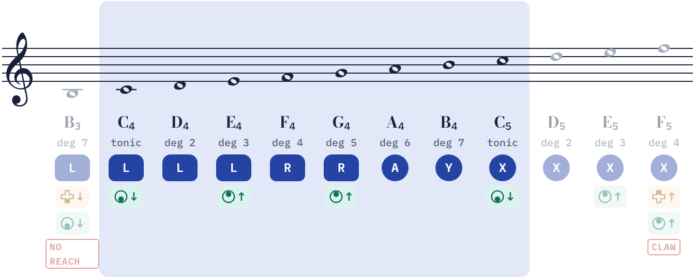

| Note | Degree | Input |
|:-:|:-:|---|
| **C4** | tonic | `L` + Stick ↓ |
| **D4** | 2 | `L` |
| **E4** | 3 | `L` + Stick ↑ |
| **F4** | 4 | `R` |
| **G4** | 5 | `R` + Stick ↑ |
| **A4** | 6 | `A` |
| **B4** | 7 | `Y` |
| **C5** | tonic | `X` + Stick ↓ |

Also in range outside the octave: B3 (`L` + D-pad ↓ + Stick ↓), D5 (`X`), E5 (`X` + Stick ↑), F5 (`X` + D-pad ↑ + Stick ↑)

## G major

**Easy** · Perform **D4–D5** (5th to 5th) · Thumb: D-pad + stick

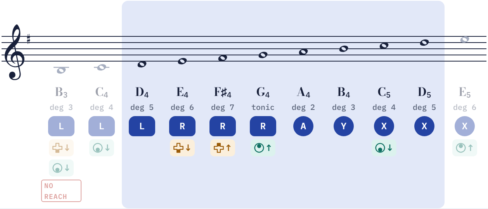

| Note | Degree | Input |
|:-:|:-:|---|
| **D4** | 5 | `L` |
| **E4** | 6 | `R` + D-pad ↓ |
| **F♯4** | 7 | `R` + D-pad ↑ |
| **G4** | tonic | `R` + Stick ↑ |
| **A4** | 2 | `A` |
| **B4** | 3 | `Y` |
| **C5** | 4 | `X` + Stick ↓ |
| **D5** | 5 | `X` |

> The tonic octave doesn't fit between B3 and F5, so this key is performed from the 5th.

Also in range outside the octave: B3 (`L` + D-pad ↓ + Stick ↓), C4 (`L` + Stick ↓), E5 (`X` + Stick ↑)

## D major

**Easy** · Perform **D4–D5** (tonic to tonic) · Thumb: D-pad + stick

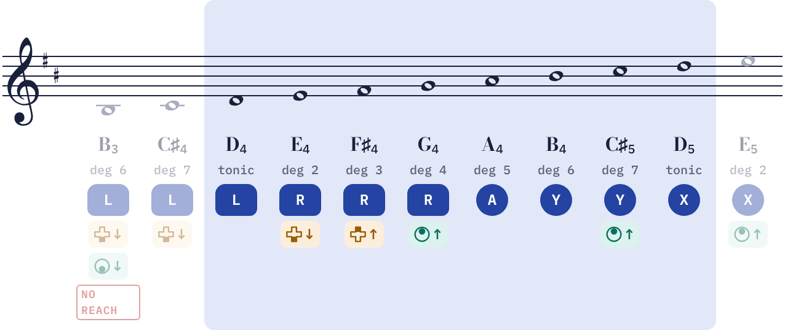

| Note | Degree | Input |
|:-:|:-:|---|
| **D4** | tonic | `L` |
| **E4** | 2 | `R` + D-pad ↓ |
| **F♯4** | 3 | `R` + D-pad ↑ |
| **G4** | 4 | `R` + Stick ↑ |
| **A4** | 5 | `A` |
| **B4** | 6 | `Y` |
| **C♯5** | 7 | `Y` + Stick ↑ |
| **D5** | tonic | `X` |

Also in range outside the octave: B3 (`L` + D-pad ↓ + Stick ↓), C♯4 (`L` + D-pad ↓), E5 (`X` + Stick ↑)

## A major

**Easy** · Perform **E4–E5** (5th to 5th) · Thumb: D-pad + stick

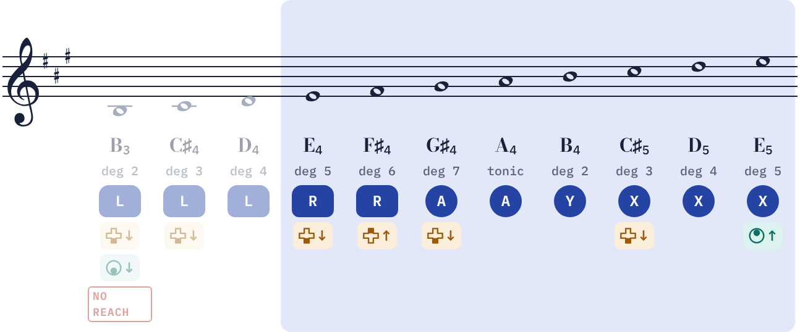

| Note | Degree | Input |
|:-:|:-:|---|
| **E4** | 5 | `R` + D-pad ↓ |
| **F♯4** | 6 | `R` + D-pad ↑ |
| **G♯4** | 7 | `A` + D-pad ↓ |
| **A4** | tonic | `A` |
| **B4** | 2 | `Y` |
| **C♯5** | 3 | `X` + D-pad ↓ |
| **D5** | 4 | `X` |
| **E5** | 5 | `X` + Stick ↑ |

> The tonic octave doesn't fit between B3 and F5, so this key is performed from the 5th.

Also in range outside the octave: B3 (`L` + D-pad ↓ + Stick ↓), C♯4 (`L` + D-pad ↓), D4 (`L`)

## E major

**Moderate** · Perform **E4–E5** (tonic to tonic) · Thumb: D-pad + stick

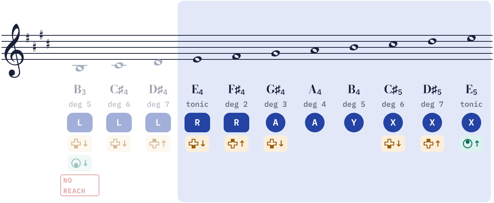

| Note | Degree | Input |
|:-:|:-:|---|
| **E4** | tonic | `R` + D-pad ↓ |
| **F♯4** | 2 | `R` + D-pad ↑ |
| **G♯4** | 3 | `A` + D-pad ↓ |
| **A4** | 4 | `A` |
| **B4** | 5 | `Y` |
| **C♯5** | 6 | `X` + D-pad ↓ |
| **D♯5** | 7 | `X` + D-pad ↑ |
| **E5** | tonic | `X` + Stick ↑ |

Also in range outside the octave: B3 (`L` + D-pad ↓ + Stick ↓), C♯4 (`L` + D-pad ↓), D♯4 (`L` + D-pad ↑)

## B major (C♭)

**Not practical** · Perform **B3–B4** (tonic to tonic) · Thumb: D-pad + stick

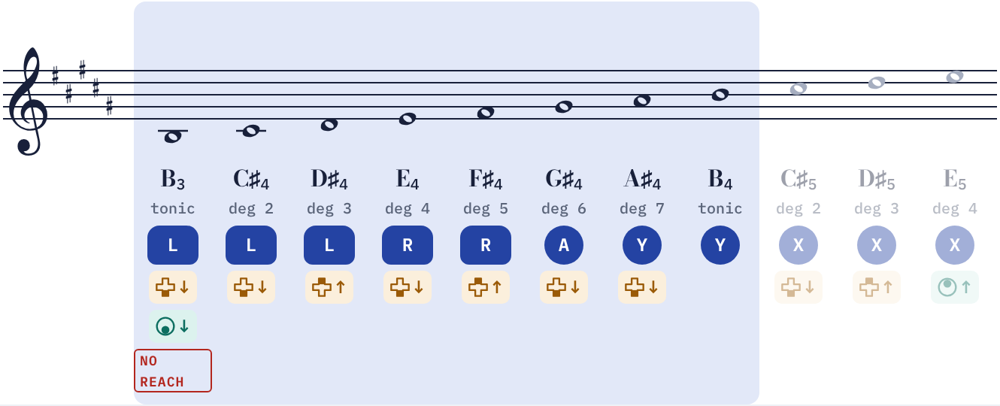

| Note | Degree | Input |
|:-:|:-:|---|
| **B3** | tonic | `L` + D-pad ↓ + Stick ↓ ⛔ out of reach |
| **C♯4** | 2 | `L` + D-pad ↓ |
| **D♯4** | 3 | `L` + D-pad ↑ |
| **E4** | 4 | `R` + D-pad ↓ |
| **F♯4** | 5 | `R` + D-pad ↑ |
| **G♯4** | 6 | `A` + D-pad ↓ |
| **A♯4** | 7 | `Y` + D-pad ↓ |
| **B4** | tonic | `Y` |

> **No playable octave.** The only B octave in range starts on low B3, which needs L, the D-pad and the stick at once. Play inside C♯4–E5 instead.

Also in range outside the octave: C♯5 (`X` + D-pad ↓), D♯5 (`X` + D-pad ↑), E5 (`X` + Stick ↑)

## G♭ major (F♯)

**Easy** · Perform **D♭4–D♭5** (5th to 5th) · Thumb: D-pad only

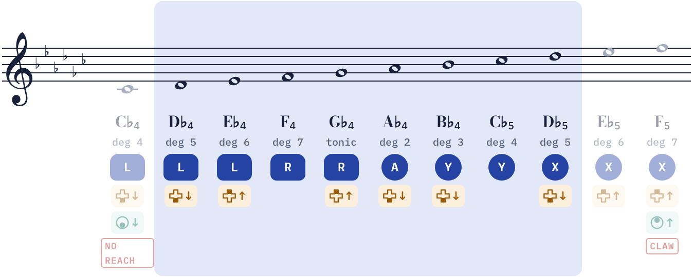

| Note | Degree | Input |
|:-:|:-:|---|
| **D♭4** | 5 | `L` + D-pad ↓ |
| **E♭4** | 6 | `L` + D-pad ↑ |
| **F4** | 7 | `R` |
| **G♭4** | tonic | `R` + D-pad ↑ |
| **A♭4** | 2 | `A` + D-pad ↓ |
| **B♭4** | 3 | `Y` + D-pad ↓ |
| **C♭5** | 4 | `Y` |
| **D♭5** | 5 | `X` + D-pad ↓ |

> The tonic octave doesn't fit between B3 and F5, so this key is performed from the 5th.

Also in range outside the octave: C♭4 (`L` + D-pad ↓ + Stick ↓), E♭5 (`X` + D-pad ↑), F5 (`X` + D-pad ↑ + Stick ↑)

## D♭ major (C♯)

**Moderate** · Perform **D♭4–D♭5** (tonic to tonic) · Thumb: D-pad only

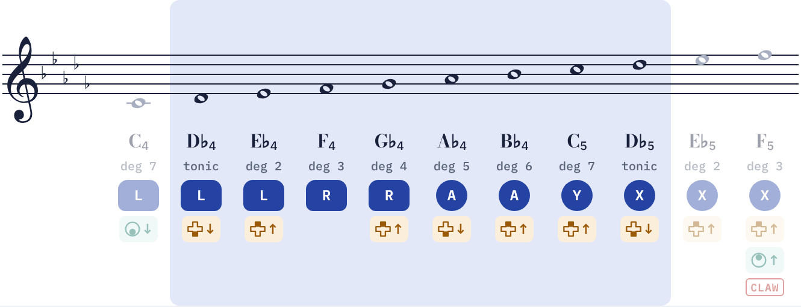

| Note | Degree | Input |
|:-:|:-:|---|
| **D♭4** | tonic | `L` + D-pad ↓ |
| **E♭4** | 2 | `L` + D-pad ↑ |
| **F4** | 3 | `R` |
| **G♭4** | 4 | `R` + D-pad ↑ |
| **A♭4** | 5 | `A` + D-pad ↓ |
| **B♭4** | 6 | `A` + D-pad ↑ |
| **C5** | 7 | `Y` + D-pad ↑ |
| **D♭5** | tonic | `X` + D-pad ↓ |

Also in range outside the octave: C4 (`L` + Stick ↓), E♭5 (`X` + D-pad ↑), F5 (`X` + D-pad ↑ + Stick ↑)

## A♭ major

**Hard** · Perform **E♭4–E♭5** (5th to 5th) · Thumb: D-pad + stick

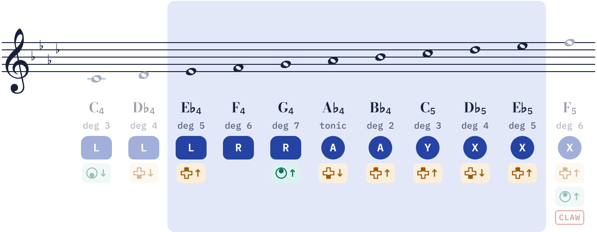

| Note | Degree | Input |
|:-:|:-:|---|
| **E♭4** | 5 | `L` + D-pad ↑ |
| **F4** | 6 | `R` |
| **G4** | 7 | `R` + Stick ↑ |
| **A♭4** | tonic | `A` + D-pad ↓ |
| **B♭4** | 2 | `A` + D-pad ↑ |
| **C5** | 3 | `Y` + D-pad ↑ |
| **D♭5** | 4 | `X` + D-pad ↓ |
| **E♭5** | 5 | `X` + D-pad ↑ |

> The tonic octave doesn't fit between B3 and F5, so this key is performed from the 5th.

Also in range outside the octave: C4 (`L` + Stick ↓), D♭4 (`L` + D-pad ↓), F5 (`X` + D-pad ↑ + Stick ↑)

## E♭ major

**Moderate** · Perform **E♭4–E♭5** (tonic to tonic) · Thumb: D-pad + stick

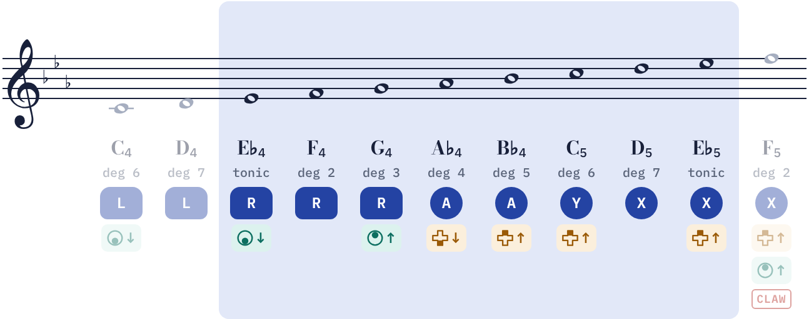

| Note | Degree | Input |
|:-:|:-:|---|
| **E♭4** | tonic | `R` + Stick ↓ |
| **F4** | 2 | `R` |
| **G4** | 3 | `R` + Stick ↑ |
| **A♭4** | 4 | `A` + D-pad ↓ |
| **B♭4** | 5 | `A` + D-pad ↑ |
| **C5** | 6 | `Y` + D-pad ↑ |
| **D5** | 7 | `X` |
| **E♭5** | tonic | `X` + D-pad ↑ |

Also in range outside the octave: C4 (`L` + Stick ↓), D4 (`L`), F5 (`X` + D-pad ↑ + Stick ↑)

## B♭ major

**Hard** · Perform **F4–F5** (5th to 5th) · Thumb: D-pad + stick

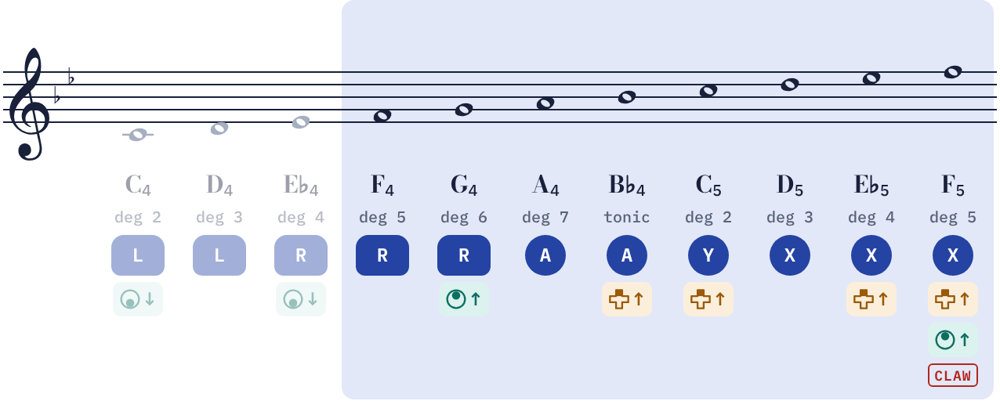

| Note | Degree | Input |
|:-:|:-:|---|
| **F4** | 5 | `R` |
| **G4** | 6 | `R` + Stick ↑ |
| **A4** | 7 | `A` |
| **B♭4** | tonic | `A` + D-pad ↑ |
| **C5** | 2 | `Y` + D-pad ↑ |
| **D5** | 3 | `X` |
| **E♭5** | 4 | `X` + D-pad ↑ |
| **F5** | 5 | `X` + D-pad ↑ + Stick ↑ ⚠️ claw grip |

> **Top note needs a claw grip.** F5 takes the D-pad and stick together. For a passage without it, stay inside C4–E♭5.

Also in range outside the octave: C4 (`L` + Stick ↓), D4 (`L`), E♭4 (`R` + Stick ↓)

## F major

**Easy** · Perform **C4–C5** (5th to 5th) · Thumb: D-pad + stick

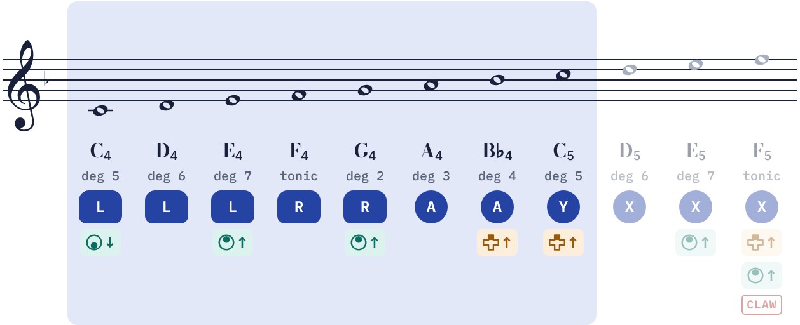

| Note | Degree | Input |
|:-:|:-:|---|
| **C4** | 5 | `L` + Stick ↓ |
| **D4** | 6 | `L` |
| **E4** | 7 | `L` + Stick ↑ |
| **F4** | tonic | `R` |
| **G4** | 2 | `R` + Stick ↑ |
| **A4** | 3 | `A` |
| **B♭4** | 4 | `A` + D-pad ↑ |
| **C5** | 5 | `Y` + D-pad ↑ |

> The tonic octave doesn't fit between B3 and F5, so this key is performed from the 5th.

Also in range outside the octave: D5 (`X`), E5 (`X` + Stick ↑), F5 (`X` + D-pad ↑ + Stick ↑)

---

*Pitch names follow the original game's layout (L = D4 through X = D5). Nintendo hasn't published the remake's sounding octave, so treat octave numbers as written pitch.*

*Difficulty scores the performance octave played up and down: each D-pad press, each stick tilt, each switch of the thumb between D-pad and stick, and claw-grip notes. Alternative inputs for every note are in [Ocarina Note Chart.md](Ocarina%20Note%20Chart.md).*
