# Ocarina Note Chart

*The Legend of Zelda: Ocarina of Time* (Nintendo Switch 2): every pitch the ocarina can play, and every way to play it.

Five note buttons, each bent by the D-pad (half step) and the left stick (whole step). The two stack, so each button reaches three semitones either side of its natural pitch.

**19 pitches · 45 inputs · range B3–F5**

## Natural notes

| Button | L | R | A | Y | X |
|---|:-:|:-:|:-:|:-:|:-:|
| Pitch | D4 | F4 | A4 | B4 | D5 |

These five are the only notes the game uses to recognize songs. Bends are for free play.

## Modifiers

| Semitones | Hold with the note button |
|:-:|---|
| +3 | D-pad ↑ + Stick ↑ (claw grip) |
| +2 | Stick ↑ |
| +1 | D-pad ↑ · or D-pad ↓ + Stick ↑ |
| −1 | D-pad ↓ · or D-pad ↑ + Stick ↓ |
| −2 | Stick ↓ |
| −3 | D-pad ↓ + Stick ↓ (claw grip) |

## Every pitch, low to high

The **bold** input is the easiest: fewest inputs, with the D-pad preferred over the stick because it lands the pitch exactly.

| Pitch | Staff | Inputs |
|:-:|:-:|---|
| **B3** | 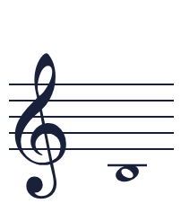 | **`L` + D-pad ↓ + Stick ↓ &nbsp;*(L −3)*** |
| **C4** | 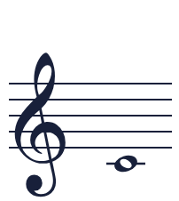 | **`L` + Stick ↓ &nbsp;*(L −2)*** |
| **C♯4** D♭4 | 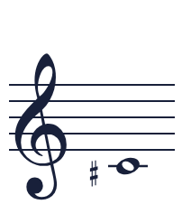 | **`L` + D-pad ↓ &nbsp;*(L −1)*** `L` + D-pad ↑ + Stick ↓ &nbsp;*(L −1)* |
| **D4** *song note* | 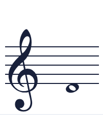 | **`L` &nbsp;*(L 0)*** `R` + D-pad ↓ + Stick ↓ &nbsp;*(R −3)* |
| **D♯4** E♭4 | 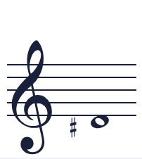 | **`L` + D-pad ↑ &nbsp;*(L +1)*** `R` + Stick ↓ &nbsp;*(R −2)* `L` + D-pad ↓ + Stick ↑ &nbsp;*(L +1)* |
| **E4** | 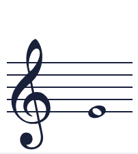 | **`R` + D-pad ↓ &nbsp;*(R −1)*** `L` + Stick ↑ &nbsp;*(L +2)* `R` + D-pad ↑ + Stick ↓ &nbsp;*(R −1)* |
| **F4** *song note* | 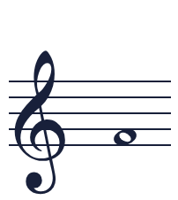 | **`R` &nbsp;*(R 0)*** `L` + D-pad ↑ + Stick ↑ &nbsp;*(L +3)* |
| **F♯4** G♭4 | 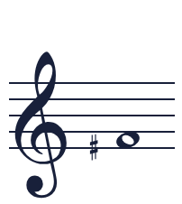 | **`R` + D-pad ↑ &nbsp;*(R +1)*** `R` + D-pad ↓ + Stick ↑ &nbsp;*(R +1)* `A` + D-pad ↓ + Stick ↓ &nbsp;*(A −3)* |
| **G4** | 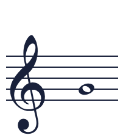 | **`R` + Stick ↑ &nbsp;*(R +2)*** `A` + Stick ↓ &nbsp;*(A −2)* |
| **G♯4** A♭4 | 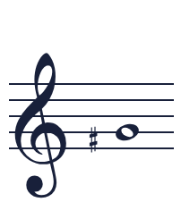 | **`A` + D-pad ↓ &nbsp;*(A −1)*** `R` + D-pad ↑ + Stick ↑ &nbsp;*(R +3)* `A` + D-pad ↑ + Stick ↓ &nbsp;*(A −1)* `Y` + D-pad ↓ + Stick ↓ &nbsp;*(Y −3)* |
| **A4** *song note* | 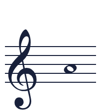 | **`A` &nbsp;*(A 0)*** `Y` + Stick ↓ &nbsp;*(Y −2)* |
| **A♯4** B♭4 | 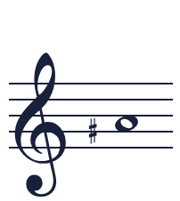 | **`A` + D-pad ↑ &nbsp;*(A +1)*** `Y` + D-pad ↓ &nbsp;*(Y −1)* `A` + D-pad ↓ + Stick ↑ &nbsp;*(A +1)* `Y` + D-pad ↑ + Stick ↓ &nbsp;*(Y −1)* |
| **B4** *song note* | 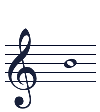 | **`Y` &nbsp;*(Y 0)*** `A` + Stick ↑ &nbsp;*(A +2)* `X` + D-pad ↓ + Stick ↓ &nbsp;*(X −3)* |
| **C5** | 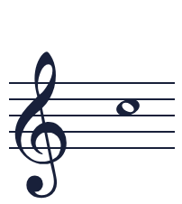 | **`Y` + D-pad ↑ &nbsp;*(Y +1)*** `X` + Stick ↓ &nbsp;*(X −2)* `A` + D-pad ↑ + Stick ↑ &nbsp;*(A +3)* `Y` + D-pad ↓ + Stick ↑ &nbsp;*(Y +1)* |
| **C♯5** D♭5 | 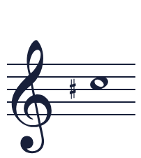 | **`X` + D-pad ↓ &nbsp;*(X −1)*** `Y` + Stick ↑ &nbsp;*(Y +2)* `X` + D-pad ↑ + Stick ↓ &nbsp;*(X −1)* |
| **D5** *song note* | 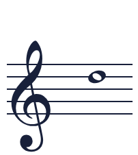 | **`X` &nbsp;*(X 0)*** `Y` + D-pad ↑ + Stick ↑ &nbsp;*(Y +3)* |
| **D♯5** E♭5 | 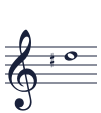 | **`X` + D-pad ↑ &nbsp;*(X +1)*** `X` + D-pad ↓ + Stick ↑ &nbsp;*(X +1)* |
| **E5** | 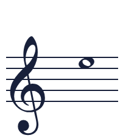 | **`X` + Stick ↑ &nbsp;*(X +2)*** |
| **F5** | 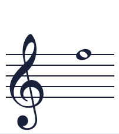 | **`X` + D-pad ↑ + Stick ↑ &nbsp;*(X +3)*** |

---

*Pitch names follow the original game's layout (L = D4 through X = D5). Nintendo hasn't published the remake's sounding octave, so treat octave numbers as written pitch.*
